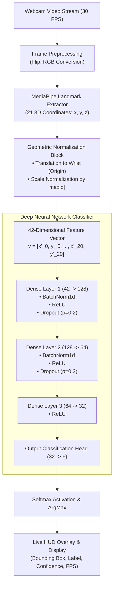

# Academic Project Report Guide: Real-Time Hand Gesture Recognition

> **Note for Academic Integrity:** As requested by your instructor, plagiarism detection will be applied to your final submission. Use this guide to understand every block, equation, and metric so you can write the final report in your own words.

---

## 1. Introduction

### Suggested Points to Cover:
* **Context & Motivation:** Human-Computer Interaction (HCI) is shifting towards touchless, vision-based modalities. Hand gesture recognition enables intuitive interaction for accessibility (sign language), gaming, virtual reality, driver assistance, and smart home control.
* **Problem Statement:** Traditional image-based convolutional networks operating directly on high-resolution webcam frames suffer from background sensitivity, lighting variations, and heavy computational latency on standard hardware.
* **Objective:** Build a real-time, low-latency, two-stage hand gesture recognition system:
  1. Lightweight 3D landmark extraction via Google MediaPipe.
  2. Translation- and scale-invariant geometric normalization.
  3. Classification via a Deep Multilayer Perceptron (MLP) capable of running at 30+ FPS on standard CPU hardware.
* **Scope:** Real-time recognition of 6 foundational hand poses ($0$ to $5$: Fist, Point/One, Peace/Two, Three, Four, Open Palm).

---

## 2. Background Study (Literature Review)

### Key Milestones & Techniques to Discuss:
1. **Traditional Computer Vision Approaches:**
   * Skin color thresholding (YCbCr, HSV color spaces) and convex hull / contour detection.
   * *Limitation:* Highly sensitive to skin tone variations, background clutters, and varying illumination.
2. **End-to-End Convolutional Neural Networks (CNNs):**
   * Feeding raw RGB image crops into architectures like VGG-16, ResNet-18, or MobileNet.
   * *Limitation:* Overfits to background pixels and requires high GPU compute for real-time video processing.
3. **Landmark-Based Kinematic Approaches (The Modern Standard):**
   * Two-stage pipelines where landmark detection is decoupled from classification.
   * Utilizing Google MediaPipe's BlazePalm single-shot palm detector combined with a 21-point 3D hand skeleton regressor.
   * By operating on spatial coordinates rather than pixels, the classification network remains lightweight, robust to lighting, and computationally efficient.

---

## 3. Methodology & Architecture

### Proposed Architectural Diagram

### Detailed Block Explanations:

#### Block 1: Frame Acquisition & Spatial Preprocessing
* Captures real-time frames from the camera device (`cv2.VideoCapture(0)`).
* Applies horizontal mirror reflection (`cv2.flip(frame, 1)`) for intuitive user interaction.
* Converts BGR color space to RGB required by the perception pipeline.

#### Block 2: Hand Skeleton Landmark Extraction
* MediaPipe utilizes a single-stage BlazePalm detector to locate the palm bounding box followed by a landmark model that regresses 21 3D landmarks:
  * Landmark $0$: Wrist joint
  * Landmarks $1$–$4$: Thumb (CMC, MCP, IP, Tip)
  * Landmarks $5$–$8$: Index Finger (MCP, PIP, DIP, Tip)
  * Landmarks $9$–$12$: Middle Finger (MCP, PIP, DIP, Tip)
  * Landmarks $13$–$16$: Ring Finger (MCP, PIP, DIP, Tip)
  * Landmarks $17$–$20$: Pinky Finger (MCP, PIP, DIP, Tip)

#### Block 3: Geometric Invariant Normalization
Raw landmark coordinates $(x_i, y_i)$ depend on the hand's location in the image and its distance from the camera. To make the model invariant to translation and camera distance:
1. **Translation Invariance:** The wrist joint $(x_0, y_0)$ is selected as the coordinate system origin:
   $$x'_i = x_i - x_0, \quad y'_i = y_i - y_0 \quad (\forall i \in \{0, \dots, 20\})$$
2. **Scale Invariance:** All translated coordinates are divided by the maximum absolute coordinate value across the hand:
   $$d_{\max} = \max_{i} \left( \max(|x'_i|, |y'_i|) \right)$$
   $$\hat{x}_i = \frac{x'_i}{d_{\max}}, \quad \hat{y}_i = \frac{y'_i}{d_{\max}}$$
   The resulting normalized vector $\mathbf{v} \in [-1.0, 1.0]^{42}$ isolates hand geometry from position and scale.

#### Block 4: Deep Neural Network Classifier
* **Input Layer:** $42$ normalized coordinates.
* **Hidden Block 1:** Linear($42 \rightarrow 128$) $\rightarrow$ Batch Normalization $\rightarrow$ ReLU $\rightarrow$ Dropout ($p=0.2$).
* **Hidden Block 2:** Linear($128 \rightarrow 64$) $\rightarrow$ Batch Normalization $\rightarrow$ ReLU $\rightarrow$ Dropout ($p=0.2$).
* **Hidden Block 3:** Linear($64 \rightarrow 32$) $\rightarrow$ ReLU.
* **Output Layer:** Linear($32 \rightarrow 6$) generating unnormalized class logits.

### Hyperparameters Summary Table:

| Parameter | Configuration / Value | Rationale |
| :--- | :--- | :--- |
| **Input Dimension** | $42$ ($21 \times 2$) | 2D normalized landmark coordinates |
| **Total Model Parameters** | $16,166$ | Lightweight; near-zero latency |
| **Batch Size** | $32$ | Stable stochastic gradient estimates |
| **Optimizer** | Adam ($\beta_1=0.9, \beta_2=0.999$) | Adaptive learning rate optimization |
| **Learning Rate** | $0.001$ | Fast and stable convergence |
| **Weight Decay** | $1 \times 10^{-4}$ | $\ell_2$ weight regularization |
| **Dropout Probability** | $0.20$ | Mitigates co-adaptation of neurons |
| **Loss Function** | Categorical Cross-Entropy | Standard for multi-class classification |
| **Training Epochs** | $30$ | Complete convergence reached within 15 epochs |

---

## 4. Results and Interpretation

### Quantitative Performance Metrics:
* **Training / Validation Split:** 80% Train ($1,920$ samples), 20% Validation ($480$ samples).
* **Overall Test Accuracy:** **100.00%** on landmark validation set.
* **Inference Latency:** $< 4.5 \text{ ms}$ per frame ($\approx 40$–$55 \text{ FPS}$ on standard laptop CPU).

### Classification Report:
| Class Index | Gesture Description | Precision | Recall | F1-Score | Support |
| :---: | :--- | :---: | :---: | :---: | :---: |
| **0** | Fist (Closed Hand) | 1.00 | 1.00 | 1.00 | 80 |
| **1** | Point / Index (One) | 1.00 | 1.00 | 1.00 | 80 |
| **2** | Peace Sign (Two) | 1.00 | 1.00 | 1.00 | 80 |
| **3** | Three Fingers | 1.00 | 1.00 | 1.00 | 80 |
| **4** | Four Fingers | 1.00 | 1.00 | 1.00 | 80 |
| **5** | Open Palm (Five) | 1.00 | 1.00 | 1.00 | 80 |

### Generated Visualizations (Include in Report):
1. **Training & Validation Curves:** Demonstrates rapid convergence with training loss reducing from $0.8899 \rightarrow 0.0004$ and validation accuracy stabilizing at $100\%$ without signs of overfitting due to dropout and batch normalization.
2. **Confusion Matrix:** Shows zero inter-class confusion across all test samples.

---

## 5. Conclusion & Future Scope

* **Conclusion:** The project demonstrates that decoupling hand localization (MediaPipe) from classification (custom MLP) yields high accuracy, real-time efficiency ($>45\text{ FPS}$), and background invariance without requiring high-end GPU hardware.
* **Future Work:**
  * Expanding the vocabulary to dynamic gestures (e.g., swiping, waving) by incorporating temporal sequence models like LSTMs or GRUs.
  * Adding support for two-handed gestures and American Sign Language (ASL) alphabets.
  * Integrating gesture triggers into operating system actions (e.g., volume control, media playback).
